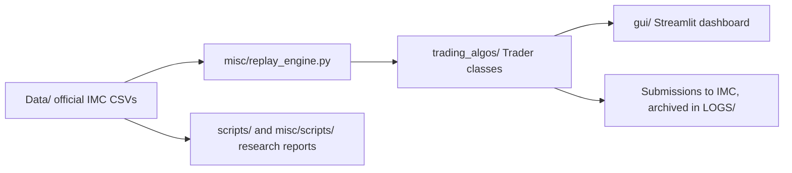

# UM Space Ducks: IMC Prosperity 4

Algorithmic trading strategies, backtesting tools, and market microstructure research built by a three-person student team for the IMC Prosperity 4 competition (April 2026).

Final result: ranked 248 of more than 19,000 teams overall, and 1st worldwide in the manual trading round.

## Why

IMC Prosperity is a multi-round trading competition on a simulated exchange with fictional products. Each round adds new instruments: simple market-making products, then correlated baskets, then European call options, and finally a tape that reveals counterparty identities. We treated it as an applied research problem: understand each market from the data first, then write the simplest strategy that exploits what we found. This repo is the full working record, including the experiments that failed.

## What is in here

- Market-making and mean-reversion strategies with rolling fair-value estimation (AR(4) and EMA forecasts) for the early rounds.
- Black-Scholes pricing, implied-volatility smile fitting, and delta-hedged option market making for the round 3 and 4 option strikes (VEV_4000 to VEV_6500).
- Counterparty analysis for round 4, where the tape names synthetic bot traders ("Mark 01" to "Mark 67"): per-bot PnL reconstruction from the tape, and strategies that follow the profitable bots and fade the unprofitable ones.
- An offline replay engine (`misc/replay_engine.py`) that replays any strategy over the official CSVs with a simple fill model.
- A Streamlit dashboard (`gui/`) that auto-discovers `Trader` classes by reflection and replays them interactively with price, book depth, RSI, position, and equity charts.
- A standalone forensic study (`bot_hunter/`) that infers trade aggressor sides from the anonymised round 1 tape and fingerprints a suspected bot with an IsolationForest outlier scan.
- Hyperparameter tuning with Optuna (`misc/tune_trader_params.py`, `tuning_spaces/`).

How the pieces fit together:



## Results with sources

- Rank 248 of 19,000+ teams overall and 1st in the manual round: final leaderboard of IMC Prosperity 4 (the manual round was played on the competition website and has no code in this repo).
- Round 3 algorithmic submissions reached about 67,000 PnL over three backtest days for our combined strategy; the per-submission figures are recorded in the `LOGS/ROUND3/` folder names and in the docstrings of the archived files.
- The tutorial emerald strategy scored +1,050 on the official IMC tester (recorded in `trading_algos/TUTORIAL/emerald_max_pnl_algo.py`).

We used LLMs to generate candidate strategies and validated them with our own backtester; the `LOGS/` folder names record which assistant produced each candidate, and the submitted combinations were our own work on top of those candidates.

## Quickstart

Requires Python 3.10 or newer.

```bash
git clone https://github.com/m1ndl0ss/UM-Space-Ducks_IMC-Trading-Prosperity_4.git
cd UM-Space-Ducks_IMC-Trading-Prosperity_4
python -m venv .venv
.venv/Scripts/activate        # on Linux/macOS: source .venv/bin/activate
pip install -r requirements.txt
```

Run the interactive dashboard:

```bash
python -m streamlit run gui/dashboard.py
```

Run a research report or the bot forensics from the repo root:

```bash
python scripts/round3_volatility_report.py
python bot_hunter/analyze_bot.py
```

Run the tests:

```bash
pip install -r requirements-dev.txt
python -m pytest tests/
```

## Project structure

| Path | Contents |
|---|---|
| `Data/` | Official IMC price and trade CSVs per round (tutorial through round 4) |
| `trading_algos/` | Strategies by round; `no/`, `bad_results/`, and `ERROR/` subfolders keep rejected variants on purpose, as a record of what did not work |
| `LOGS/` | Algorithms exactly as submitted, named by IMC submission id; folder names record the backtest PnL and provenance. Kept verbatim, excluded from formatting |
| `gui/` | Streamlit dashboard with reflective strategy discovery |
| `misc/` | Replay engine, trimmed data model, Optuna tuner, counterparty research with committed outputs |
| `scripts/`, `misc/scripts/` | Command-line research reports (volatility, path risk, per-bot PnL) |
| `ROUND3/` | Round 3 options analysis: IV smile fits, autocorrelation, delta-neutral prototype |
| `bot_hunter/` | Self-contained round 1 bot forensics with its own runner |
| `datamodel.py` | The official IMC-provided data model that strategies import |
| `tests/` | Pytest suite for the data model, replay engine, and option pricing |

## Limitations

- This is competition research code written under time pressure, not production software. The failed experiments are kept deliberately.
- The replay engine uses a simplified fill model; its PnL ranks parameter settings but does not match the live exchange exactly.
- `Data/ROUND4/prices_round_4_day_1.csv` and `day_2.csv` are byte-identical to the corresponding round 3 files. We have left them as downloaded; round 4 analysis should rely on `day_3` and the trade tapes.
- The manual round (where the team placed 1st) was solved on the competition website, so it is not represented here.
- The archived submissions in `LOGS/` require the IMC platform to run; they are not local entry points.

## Team

- Matvei Kandalintsev ([kandalintsev.com](https://kandalintsev.com))
- Anastasios Vlachmpeis
- Minseok Choi

## Acknowledgements

- A friend of the team contributed the round 3 option strategy archived as "Friend's Algo" in `LOGS/ROUND3/`; the moneyness-smile idea in our round 4 option work builds on it.
- Two archived strategies adapt ideas and code from Jasper van Merle's (jmerle) public IMC Prosperity repositories; the files cite the upstream sources.
- The market data in `Data/` and the backtest logs were produced by IMC's Prosperity 4 competition platform and belong to IMC. They are included only to make the research reproducible.

## Licence

The code is released under the MIT Licence (see `LICENSE`). The licence does not cover the IMC competition data described above.

## Contact

Matvei Kandalintsev, contact@kandalintsev.com, [kandalintsev.com](https://kandalintsev.com)
